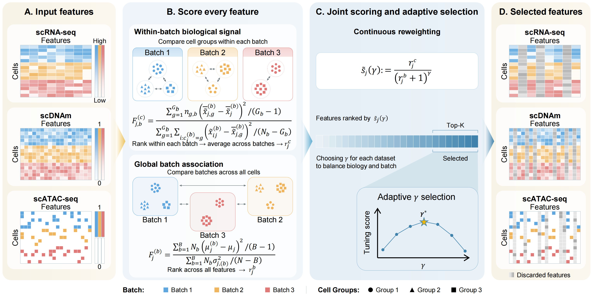

[](https://pypi.org/project/scDecant/)

# DECANT prioritizes biological heterogeneity over batch effects for various single-cell omics data



## Package installation

It is recommended to create a new environment for scDecant.

```bash
conda create -n scDecant python==3.10
conda activate scDecant
```

scDecant is available on PyPI and can be installed using

```bash
pip install scDecant
```

Install time (< 10 min)

## Tutorial

One notebook per omics is provided under [tutorials](tutorials):

- `01_RNA_pancreas.ipynb`
- `02_methylation_tian_a5a7.ipynb`
- `03_ATAC_mousebrain.ipynb`

Each notebook loads a dataset and runs DECANT. The datasets are not shipped;
download them from [Google Drive](https://drive.google.com/drive/folders/1gQBjm_2TH0Ozjg_jO_7rwSgeKNp8emVh?usp=sharing).

## Quick start

DECANT ranks each feature by a within-batch biological signal rank (`Fc`, written
`r_j^c` in the figure) and a global batch association rank (`Fb`, `r_j^b`), and keeps
the top features by

```text
score = Fc_rank ** alpha / (Fb_rank + 1) ** gamma        (alpha = 1)
```

It scans the exponent `gamma`, keeps the value with the highest unsupervised
tuning score, and returns the selected features together with a PCA embedding.
Downstream evaluation is left to the caller.

### Input format

An `AnnData` object of shape `n_obs` x `n_vars`:

- `adata.X`: log1p expression (RNA), methylation level in `[0, 1]`
  (methylation), or binarized peak accessibility (0/1; ATAC).
- `adata.obs[batch_key]`: batch label.
- `adata.obs[label_key]`: cell-type label, used for evaluation only.

### Run DECANT

```python
import scanpy as sc
from decant import calc_overall, evaluate_metrics, run_decant

adata = sc.read_h5ad("path/to/pancreas.h5ad")
# The example data are already normalized and log1p-transformed.
# For raw counts, first run:
# sc.pp.normalize_total(adata, target_sum=1e4)
# sc.pp.log1p(adata)
sc.pp.filter_genes(adata, min_cells=3)
result = run_decant(adata, omics="rna", batch_key="tech", n_features=2000)

metrics = evaluate_metrics(result["embedding"], "X_pca", "tech", "celltype")
metrics["Overall"] = calc_overall(metrics, result["n_batches"])
print(result["adaptive_gamma"], metrics["Overall"])
```

Set `omics` to `"rna"`, `"meth"`, or `"atac"`. `batch_key` and `label_key` are
the column names of the batch and cell-type annotations in your own
`adata.obs`; the cell-type label is used only for evaluation.

`n_features` is the number of features DECANT keeps. We use 2,000 genes for
scRNA-seq, 10,000 regions for scDNAm, and for scATAC-seq the number of peaks
passing a 3% prevalence filter (capped at 30,000); adjust it for your own data.

### Output

The DECANT output is the selected feature set: `result["selected_indices"]`, the
top-`K` subset returned by the ranking, together with its PCA embedding
`result["embedding"]` and the adaptively chosen `result["adaptive_gamma"]`.
Subset your data with `adata[:, result["selected_indices"]]` to pass these
features to a downstream dimensionality-reduction, integration, or clustering
method.

`evaluate_metrics` and `calc_overall` are only for benchmarking the embedding.
`evaluate_metrics` returns six metrics: `AMI`, `ARI`, and `NMI` (biological
conservation), and `batchASW`, `Graph_connectivity`, and `iLISI` (batch mixing).
`calc_overall` combines them into a single score:

```text
iLISI_norm = (iLISI - 1) / (n_batch - 1)
Overall    = 0.4 * mean(batchASW, Graph_connectivity, iLISI_norm)
           + 0.6 * mean(AMI, ARI, NMI)
```
